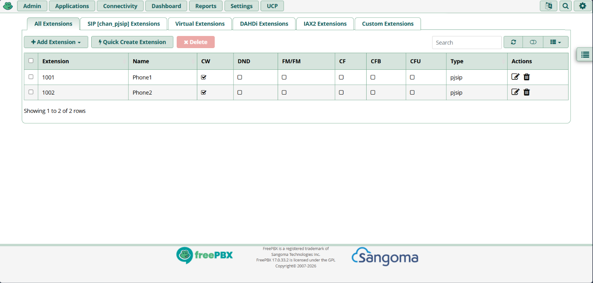
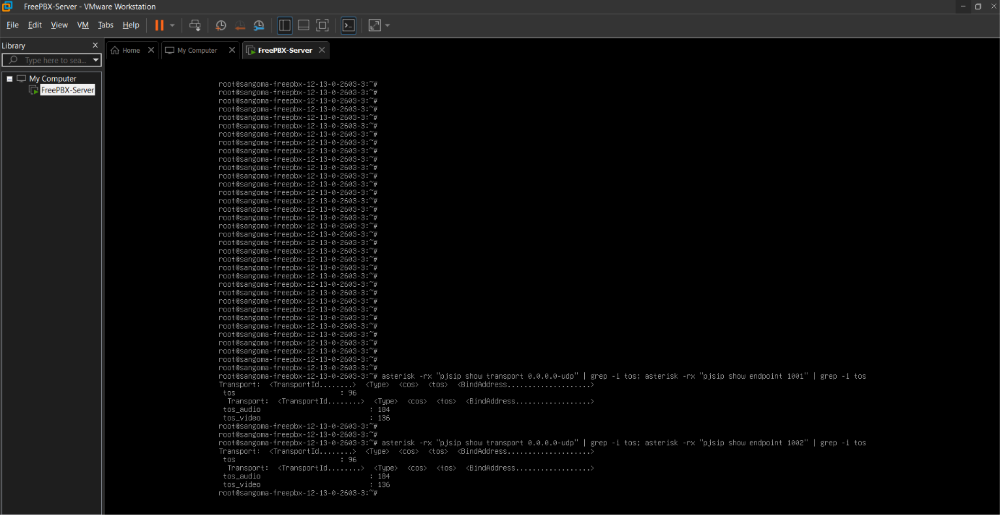

# VoIP & Unified Communications Lab: Open-Source PBX Deployment with Layer-3 QoS Priority Markings

## 📌 Project Overview
This project demonstrates the engineering deployment, configuration, and optimization of an enterprise-grade VoIP (Voice over Internet Protocol) session architecture. The core objective is to construct an isolated Unified Communications network environment that separates signaling and media control loops, establishes stable client endpoint registrations, and implements strict Quality of Service (QoS) network prioritization layers to prevent voice packet degradation across a local area network.

---

## 🛠️ Technical Infrastructure Architecture

* **Hypervisor Virtualization Layer:** VMware Workstation Pro
* **Operating System Platform:** Linux Debian 12 (64-bit Core)
* **IP-PBX Telephony System:** FreePBX 17 Deployment Bundle
* **Foundational VoIP Engine:** Asterisk 23 Core Backend
* **Communication Protocol Framework:** PJSIP Stack (Modern Session Initiation Protocol Stack)
* **Client Software Endpoints:** MicroSIP Client Engine & Zoiper Mobile Client Platform
* **Network Allocation Mode:** VMware Layer-2 NAT Network Virtualization with Port-Mapping Address Translations (127.0.0.1:8080 -> Virtual Guest Port 80)

---

## 🚀 Technical Implementations & Project Milestones

### 1. Hard Drive Partitioning and Host Shell Assembly
* **Resource Provisioning:** Configured a 60 GB single-file virtual hard drive subsystem tailored for high IOPS database management.
* **Storage Allocation:** Automated structural logical mapping configurations to separate internal application directories and root layers.
* **Hardware Policies:** Assigned hardware access states using custom settings rules to secure host resource consumption.

### 2. Network Interface Correction & Socket Stability Configuration
* **Power Management Patching:** Diagnosed and resolved hypervisor adapter power-drop disconnect loops triggered by host machine power-saving sleep states.
* **Topology Isolation:** Migrated the virtual machine from an unstable physical broadcast bridge over to a completely isolated Network Address Translation (NAT) segment.
* **Loopback Port Forwarding:** Authored explicit port forwarding translation maps within the hypervisor network manager layer, mapping `127.0.0.1:8080` safely back to the virtual guest port 80 loopback socket framework.

### 3. Endpoint Provisioning and Handshake Verification
* **PJSIP Security Profiling:** Constructed isolated user authentication parameters within the underlying backend PJSIP database tables.
* **Extension Provisioning:** Formulated two distinct secure endpoints: **Extension 1001 (Phone1)** and **Extension 1002 (Phone2)**.
* **Handshake Validation:** Generated robust cryptographic registration keys and validated real-time client bindings via inbound SIP registration handshake protocols.

### 4. Advanced Layer-3 QoS Pipeline Implementation
* **Low-Level Customization:** Bypassed GUI interface limitations by directly altering the Asterisk configuration files to inject specific Layer-3 packet tracking bits.
* **Signaling Optimization:** Modified `/etc/asterisk/pjsip.transports_custom_post.conf` to assign `tos=cs3` and `cos=3`, injecting Class Selector 3 tracking priority headers across all outbound SIP call control signaling data packets.
* **Media Stream Prioritization:** Modified `/etc/asterisk/pjsip.endpoint_custom_post.conf` to map `tos_audio=ef` and `cos_audio=5` for both operational extensions. This forces the system kernel memory cache to tag outbound Real-time Transport Protocol (RTP) audio stream segments with strict Expedited Forwarding (EF) data bits, instructing network switches to prioritize voice streams ahead of standard bulk web data payloads.

---

## 📊 Lab Artifacts & Project Verification Data

### Figure 1: Virtual Hardware Shell and Storage Allocation
Confirms successful deployment of the 60 GB virtual storage subsystem and the active Linux console engine runtime environment.

### Figure 2: Application Endpoint Workspace Table
Displays the active FreePBX web management registry verifying the complete logical compilation of Extensions 1001 and 1002.

### Figure 3: Asterisk Production Kernel QoS Properties Audit
Proves live injection of the manually compiled Class Selector 3 signaling parameters and Expedited Forwarding audio flags running inside the production system cache.

### Figure 4: Live VoIP Bi-directional Call Session
Captures a running voice call stream demonstrating a stable, multi-minute, two-way connection across the local area network.

### Figure 5: Mobile Client SIP Handshake Status
Shows the mobile software endpoint successfully registered and authenticated to the private IP address target.

